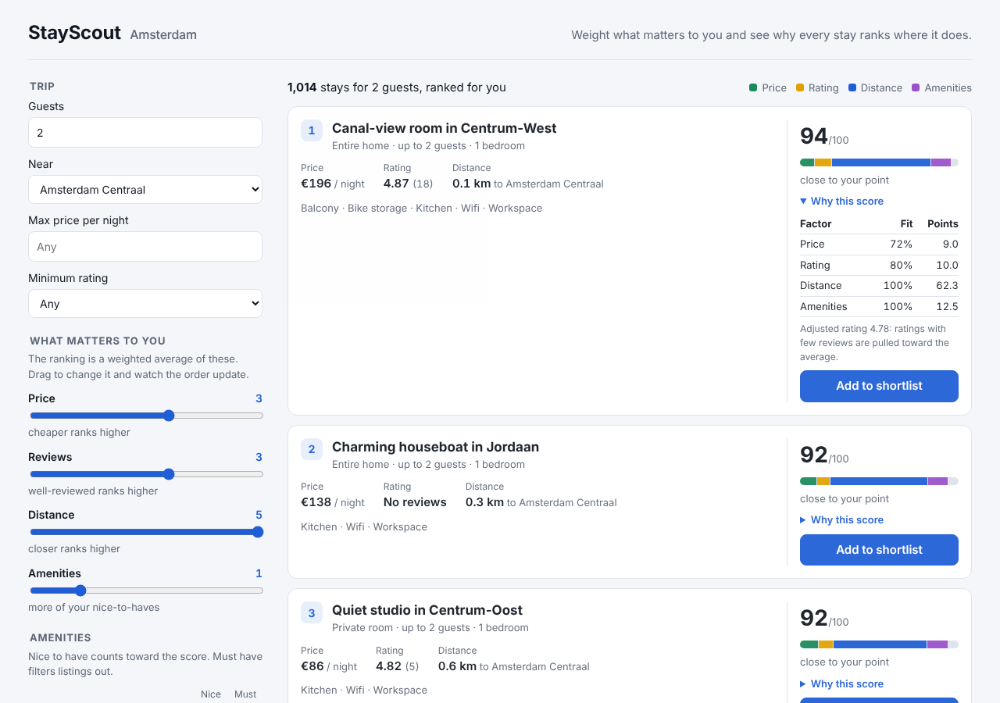

# StayScout

**An accommodation search for Amsterdam that tells you *why* each stay ranks where it does.**

You pick what matters (price, reviews, distance to a place you care about, amenities) and set how much each one matters. StayScout ranks every matching stay and shows each result's score split into points per factor, so the order is never a black box.



## The problem

Most travel searches sort on one thing at a time ("price low to high") or on an opaque "recommended" score. Real choices are trade-offs: a €20 cheaper room 3 km further out with a 4.6 rating is better for some people and worse for others. StayScout makes the trade-off explicit and adjustable:

- **Hard filters** remove stays you'd never book (guests, max price, minimum rating, neighbourhood, room type, must-have amenities).
- **Weights** rank everything that's left. Moving a slider re-ranks the list immediately.
- **The score breakdown** on every card shows how many of its 100 points came from each factor.
- **Shortlists** let you save a few stays and share them with one link.

## How the ranking works

`packages/ranking` is a small pure-TypeScript library with no dependencies, tested in isolation.

1. **Features are scaled to 0–1 across the candidates.** Price and distance are inverted (cheaper and closer score higher), using min–max scaling over the current result set. If every candidate has the same value, they all get 1, so the factor neither helps nor hurts.
2. **Ratings are shrunk toward the average.** A 5.0 from one review shouldn't beat a 4.8 from 500 reviews, so ratings use a Bayesian average:
   `adjusted = (n·rating + m·mean) / (n + m)`, with `m = 10` prior reviews at the candidates' mean rating. A listing with no reviews gets the mean.
3. **Distance** is the great-circle (haversine) distance to the chosen point (Centraal, Rijksmuseum, RAI or Zuidas).
4. **Amenities** score the fraction of your "nice to have" amenities a stay has.
5. **Score** = weighted average of the four features, with weights normalised to sum to 1. Each factor's *contribution* is `weight × feature`, so **the contributions always add up exactly to the score.** A test checks this.
6. **Ties** are broken by listing id, so the order is fully deterministic. That makes pagination stable.

## Architecture

```
packages/ranking   Pure ranking library (scoring, Bayesian rating, haversine) + unit tests
apps/api           Fastify REST API, SQLite storage, zod input validation + integration tests
apps/web           React + TypeScript (Vite) single-page app
```

**Request flow:** the web app keeps its whole search state in the URL → calls `GET /api/listings` → the API applies hard filters in SQL → the ranking library scores the candidates in memory → the API returns one page plus an opaque cursor for the next page.

### API

| Method | Path | Purpose |
|---|---|---|
| GET | `/api/meta` | Neighbourhoods, amenities, anchors and price range for building the filters |
| GET | `/api/listings` | Filtered, ranked, paginated results with score breakdowns |
| GET | `/api/listings/:id` | One listing (404 if unknown) |
| POST | `/api/shortlists` | Save a list of listing ids, returns `{ id }` (201) |
| GET | `/api/shortlists/:id` | Fetch a shared shortlist (404 if unknown) |

Example: `GET /api/listings?guests=4&maxPrice=300&require=Kitchen&wDistance=3&anchor=rijksmuseum&limit=20`

Invalid input (for example `guests=0`, `minRating=7`, an unknown anchor or a tampered cursor) returns **400** with the offending field named.

## Design decisions and trade-offs

- **Filter in SQL, rank in TypeScript.** Hard filters are cheap, index-friendly SQL (parameterised, with indexes on `(accommodates, price)` and `neighbourhood`). Ranking needs min–max scaling over the whole candidate set, so it runs in memory after filtering. That is fine for thousands of rows; for millions, I would precompute features and push a first-stage ranking into the database or a search engine.
- **Ranking is a separate pure package.** It has no I/O, so it is easy to unit-test and could run in the browser too.
- **Explainability is a hard requirement, not a feature.** A linear weighted score was chosen over a learned model because each factor's contribution is exact and can be shown to the user.
- **Cursor pagination.** The cursor is an opaque base64url token, so clients can't depend on its format and it can change later (for example to keyset pagination) without breaking them. Because ranking is deterministic, pages never overlap or skip items; a test pages through everything and checks it matches the unpaginated order.
- **URL as state.** Every search is a shareable, bookmarkable link, and the back button works.
- **Validation at the edge.** zod schemas turn malformed input into clear 400s before any query runs.
- **SQLite via Node's built-in `node:sqlite`.** Zero native dependencies, so the project installs and runs anywhere Node 22.5+ runs, including CI.
- **Accessibility.** Labelled controls, `aria-pressed` toggles, a text alternative for the score bar, a live region for result updates, visible focus, and a layout that works at phone width.

## Data

**The listings are synthetic.** `apps/api/src/data.ts` generates 1,200 Amsterdam listings from a fixed seed, so every run and every test sees the same data. Neighbourhood names and coordinates are real; prices, ratings, review counts and amenities come from simple models (for example, central neighbourhoods are pricier, and review counts are skewed so many listings have few reviews, which is exactly where rating shrinkage matters). Replacing the generator with a real dataset (for example a public listings export) needs only a loader that produces the same `Listing` shape.

## Running it

Requires **Node 22.5 or newer**.

```bash
npm install
npm run dev:api     # API on http://localhost:3001 (creates and seeds stayscout.db on first run)
npm run dev:web     # web app on http://localhost:5173 (proxies /api to the API)
```

```bash
npm run typecheck   # TypeScript, all three packages
npm test            # 24 tests: 11 ranking unit tests + 13 API integration tests
npm run build       # production build of the web app
```

GitHub Actions runs typecheck, tests and build on every push and pull request.

## Tests

- **Ranking (unit):** haversine against a known distance; rating shrinkage (5.0 from 1 review ranks below 4.8 from 500); weight normalisation; contributions sum to the score; cheaper ranks higher when only price matters; scaling every price by a constant doesn't change the order; deterministic tie-breaking; empty and single-item inputs.
- **API (integration, in-memory database):** every hard filter is honoured; pagination is complete with no duplicates; distance-only weights sort by distance; empty results; five invalid-input cases return 400 naming the field; 404s; shortlist round-trip keeps order and note.

## Limitations and next steps

- Synthetic data. Next: load a real public dataset and add availability by date.
- Min–max scaling means a score is relative to the current result set, not absolute. That is fine for ranking, but scores shouldn't be compared across different searches.
- No authentication: shortlists are shared by unguessable id, like an unlisted link.
- In-memory ranking re-scores all candidates per request; caching or precomputed features would be needed at real scale.
- Possible extras: a map view, learning default weights from clicks, and end-to-end browser tests in CI.
